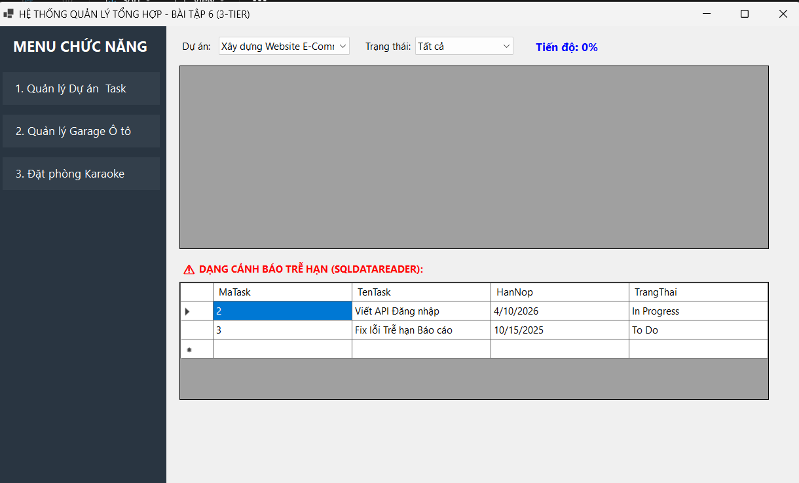
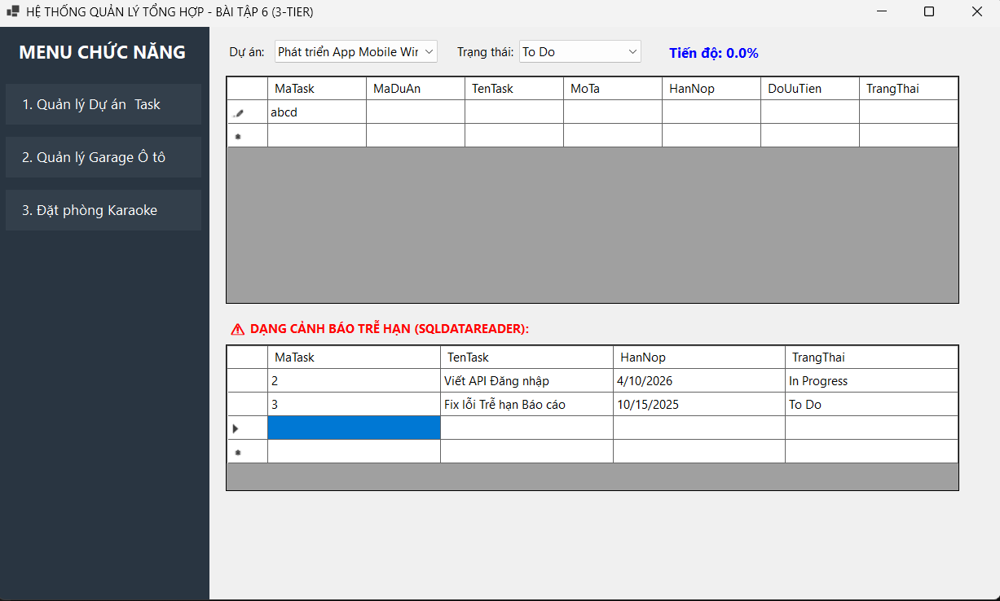
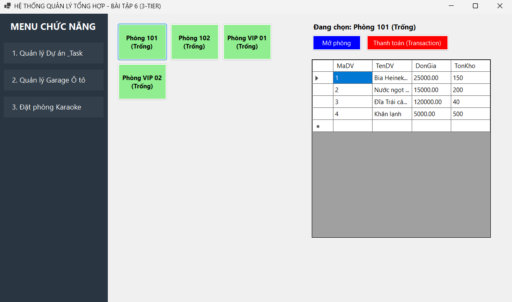
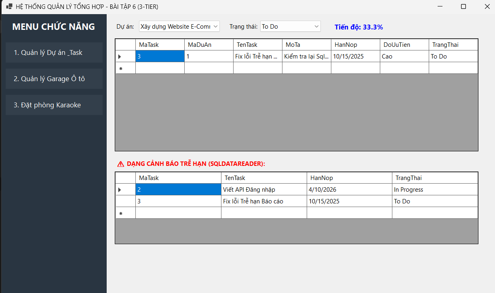
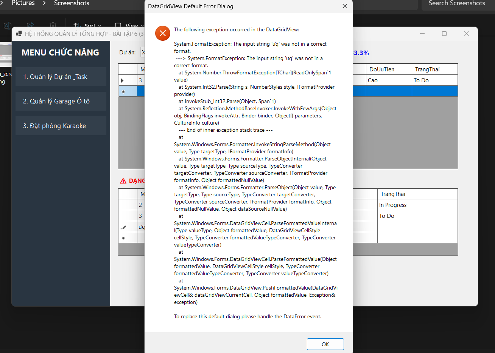

# HỆ THỐNG QUẢN LÝ TỔNG HỢP - WINFORMS 3-TIER ARCHITECTURE

## MỤC 1: THÔNG TIN SINH VIÊN

- **Họ và tên sinh viên:** Nguyễn Tiến Nhật Minh
- **Mã sinh viên:** 24810320038
- **Tên Đề tài / Bài tập:** Bài tập 6 - Tích hợp 3 ứng dụng WinForms (Quản lý Dự án / Task, Quản lý Garage Ô tô và Đặt phòng Karaoke) trên cùng một mô hình kiến trúc 3 lớp (3-Tier Architecture: GUI - BUS - DAL - DTO).

---

## MỤC 2: CẤU TRÚC DỰ ÁN (PROJECT STRUCTURE)

```text
baitapngay1011/
├── images/                         # Thư mục chứa 5 hình ảnh minh họa bài làm
│   ├── 01_main_screen.png          # Màn hình chính / Tổng quan hệ thống
│   ├── 02_crud_screen.png          # Màn hình Quản lý Danh mục (CRUD)
│   ├── 03_transaction_screen.png   # Màn hình Nghiệp vụ (Đặt phòng Karaoke)
│   ├── 04_report_screen.png        # Màn hình Báo cáo - Thống kê trễ hạn
│   └── 05_error_handling.png       # Màn hình Xử lý ngoại lệ / Báo lỗi
├── src/                            # Mã nguồn C# (.NET WinForms 3-Tier)
│   ├── GUI/                        # Tầng giao diện người dùng (Forms, UI Controls)
│   ├── BUS/                        # Tầng xử lý nghiệp vụ (Business Logic Layer)
│   ├── DAL/                        # Tầng truy xuất dữ liệu (Data Access Layer)
│   ├── DTO/                        # Tầng đối tượng truyền dữ liệu (Data Transfer Object)
│   └── Database/                   # File Script khởi tạo SQL Server tự động
├── .gitignore                      # File cấu hình loại bỏ các thư mục tạm (bin, obj)
└── README.md                       # File báo cáo tổng quan dự án
```

---

## MỤC 3: HÌNH ẢNH KẾT QUẢ CÁC MÀN HÌNH CHỨC NĂNG

### 1. Màn hình chính / Tổng quan hệ thống



### 2. Màn hình Quản lý Danh mục (CRUD)



### 3. Màn hình Nghiệp vụ chính (Đặt phòng Karaoke)



### 4. Màn hình Báo cáo - Thống kê (Tiến độ & Cảnh báo trễ hạn)



### 5. Minh họa An toàn Dữ liệu & Xử lý Lỗi (Exception Handling)


